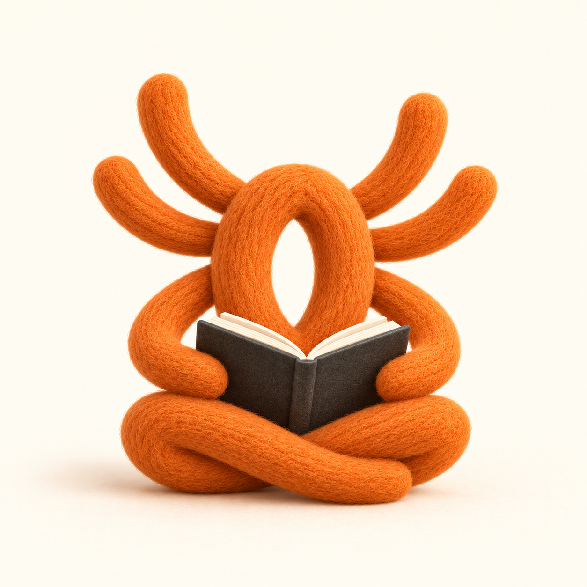
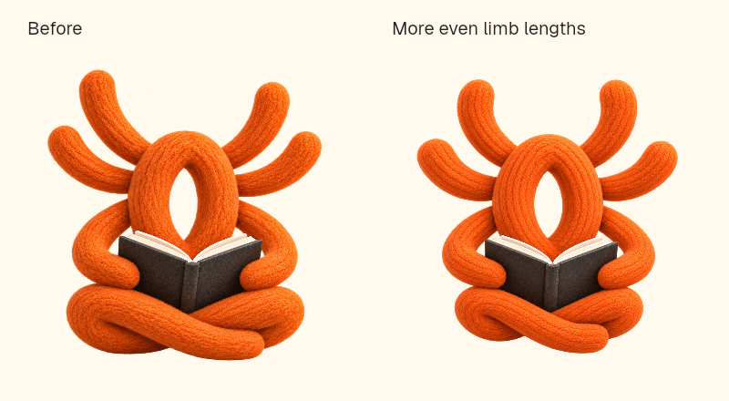

# The reading spider: intent, exploration and selection

Parent: [Investigations](../project/investigations.md). Current artwork and regeneration: [design-logo.md](../project/design-logo.md#identity-and-asset-regeneration). Implementation plan: [261024a](../plans/261024a-eight-limbed-reading-spider-brand-assets.md).

## What Greg wanted

These quotations are from the Codex design conversation on 2026-10-23/24. They record intent; the agent's selection and implementation decisions below are not quotations or independent user approvals.

> And I guess if you just have a look at it, it's intended sort of as like a spider with its hands on its hips, because Spideryarn, but also notion of like yarn, so it's kind of like a knot. And it's meant to be friendly but also distinctive.
>
> — Greg, 2026-10-23

> Also take into account the vision of the product.
>
> — Greg, 2026-10-24

The [vision](../project/vision.md) is reading deeply and efficiently: helping a human understand, interrogate, connect and remember writing. [Positioning](../project/positioning.md) also preserves the name's origin in ideas and stories weaving together. The design interpretation was a capable, curious companion, with the yarn/knot doing real work in its identity.

The exploration began with twenty close refinements of the orange mark, then six guided by that vision, then twelve more anthropomorphic characters. Greg preferred J (thinking), K (reading over a book), M (seated reading), P (wool) and R (a thoughtful lean), then pulled the expression back:

> I think the sort of eyebrows and stuff and the hands are perhaps adding a little bit too much. I want to kind of keep it at least somewhat abstract and leave a little bit to the imagination, but I have to say this is definitely adding something. I also quite like the book.
>
> Let's have one more go. Suggestive. Hint at a likeable character in a pose and/or reading. Less is more.
>
> — Greg, 2026-10-24

Eight quieter studies followed, seven without faces and one testing only two dot eyes. S was a single-colour thoughtful reader, U a faceless seated reader, and Z a woolly version of that seated reader.

> S, U, and even perhaps Z
>
> Will we need two versions (light and dark theme?)
>
> Actually I'm leaning towards Z! Though I think we need 8 limbs, for a spider, no?
>
> — Greg, 2026-10-24

Greg then explicitly delegated another generation round, independent subagent input, the winner decision, the complete asset family, documentation, commit and push. No further selection approval was required.

## Final round and decision

[Four Z-led candidates](../../assets/brand/explorations/final-round-prompts.json) used the construction four rear/free limbs + two book-support limbs + two crossed lower limbs. Both independent fresh-context simulated reviewers chose **03, the compact reader**. Their rankings, observations and limitations are preserved in [the review record](../../assets/brand/explorations/reviews.md). These are simulated perspectives, not real-user evidence. The parent accepted 03 because its gathered posture keeps attention on the book rather than a greeting gesture.

The count is the intended construction, not a claim that all concealed attachments can be anatomically traced through the knot. The central oval is a body; it does not supply additional limbs. The abstraction remains deliberate. Original [S](../../assets/brand/archive/s-quiet-thinker.png), [U](../../assets/brand/archive/u-seated-reader.png), [Z](../../assets/brand/archive/z-woolly-reader.png) and the [old mark](../../assets/brand/archive/original-logo.png) survive for comparison.

The detailed artwork was illegible as a dependable 16px favicon in actual-size review. The agent therefore selected a restrained optical companion with the same hollow core, four free ends, supporting loops, book and crossed base. It removes wool microtexture and most shading; it is a size treatment of the chosen identity. The [SVG](../../assets/brand/source/mark.svg) is editable. The [first transparent detailed master](../../assets/brand/archive/reader-before-limb-refinement.png) and [its cutout prompt/provenance](../../assets/brand/archive/reader-before-limb-refinement-generation.json) are separate from the opaque winning candidate: image generation produced a new final rendering, not a pixel-exact deterministic extraction. The current versions incorporate the limb refinement below.

## Limb-proportion refinement

> can we tweak it so that the limbs are slightly closer to all being the same length (like a spider)?
>
> — Greg, 2026-10-24

The targeted edit makes the crossed lower limbs more compact, bringing their implied length closer to the free and book-support limbs. The pose bends and conceals parts of the strands, so this is a proportion refinement, not a claim of eight mathematically equal projected lengths. The four free ends, two supports and two crossed lower limbs remain; the body loop, faceless character and open book carry the same intent.

The [current detailed master](../../assets/brand/source/reader.png) was edited with the built-in image tool; [exact prompt and input history](../../assets/brand/source/reader-generation.json). The first transparent master and [previous optical SVG](../../assets/brand/archive/mark-before-limb-refinement.svg) are archived. The optical treatment follows the same modestly shortened lower folds. A fresh simulated new-reader check accepted the change as visible but modest, found the reading pose and identity intact, and noted that overlapping lower attachments still cannot be traced independently. The upper pair also became somewhat more symmetrical. This is an agent reaction, not user research or Greg's approval of the output.

The [follow-up plan and validation](../plans/261024a-reading-spider-limb-refinement.md) record the image review, matching small mark and anatomy-dependent animation checks.

## Regeneration/library decision

Following [third-party-library-selection.md](../reusable/third-party-library-selection.md), existing code was inventoried first. There was only `scripts/make-og-card.ts`, no favicon pipeline. `@napi-rs/canvas` was already a direct dependency. Its [upstream API](https://github.com/Brooooooklyn/canvas#usage) supports image decode, drawing/scaling and PNG encoding.

On 2026-10-24, registry metadata reported `png-to-ico` **3.0.2**, Node >=20, with `pngjs`, `minimist` and Node types as dependencies; `favicons` **7.3.1**, Node >=20, adds `sharp`, XML and HTML helpers. The [png-to-ico upstream API](https://github.com/steambap/png-to-ico#usage) accepts an array of exact-size PNG frames. The [favicons API](https://github.com/itgalaxy/favicons#usage) covers a much broader platform family. **Decision:** reuse canvas and add the small, established `png-to-ico` dev dependency for the actual missing format operation. No second native raster stack, custom ICO codec, or whole favicon-platform configuration was needed.

The source-to-assets command and current background/padding policy have one home in [design-logo.md](../project/design-logo.md#identity-and-asset-regeneration). Repeat runs are checked byte-for-byte in the recorded environment. Social-card rendering retains its existing browser/font prerequisite, so cross-OS screenshot byte identity is not promised.

## Validation record

Selection review found the old PNG-specific Semaphore animation to be an integration risk. Its previous clipping coordinates selected the wrong portions of the new optical mark; the implementation remeasures it rather than documenting a broken effect. Final code review and gate results are recorded in the [plan](../plans/261024a-eight-limbed-reading-spider-brand-assets.md).
