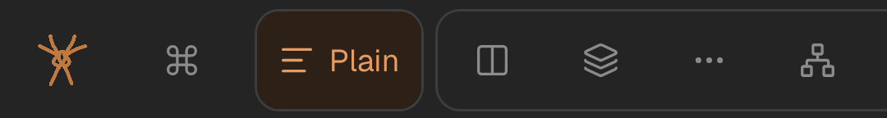

# The More button straight after Summary in the bottom bar

Report spya-hdde62 (SPIDERYARN-READING2-HH, #568), Greg, 2026-10-11, from
`/read/rhizome-1000-plateaus-introduction-lambert-says-spya-jc9azw`, a suggestion. Queue item
`qi-8f4jc4h3`.

> In the bottom bar, we have the triple dot more button that displays more modes. Let's move that
> to the right of the summary, and maybe, maybe to the right of the skim mode.

Up: [reading-view-overview.md](../project/reading-view-overview.md) via
[mode.md](../project/mode.md) (`MODES_UI` is the bar's order).

## What Greg saw

On a wide screen More already stands after Skim, at the end of the Structure–Summary run
([261008d](261008d-bottom-bar-groups-skim-and-more-join-structure-and-summary-comments-joins-marginalia.md)).
On a phone with Experimental on, which is Greg's account, or with Diagram open, that place is off the edge, so More
**leads** the frame instead: `[Plain] [⋯ Structure Summary Diagram Skim | …]`
([261009c](261009c-phone-bottom-bar-more-leads-the-bands-frame-when-its-place-is-off-screen.md),
whose debrief flagged exactly this cost). The report has no diagnostics, so which of the two he
saw is not recorded. Either way, his first choice, after Summary, is a real move on both.

## The decision

**More's home is straight after Summary, on every screen**:
`[Plain] [Structure Summary ⋯ Diagram Skim | Sources …]`.

- One constant. `MORE_AFTER` in [`src/web/Dock.tsx`](../../src/web/Dock.tsx) names a **mode**
  (`summary`) instead of a run (`shape`), and `cutForMore` cuts after that drawn row. If that row
  is not drawn, which cannot happen today because Summary is never experimental, More goes at the
  end, as it already does when its run is missing.
- Same run, so no separator line moves: More is not a row and `groupStarts` reads rows only.
- **On a phone this also ends the leading case for today's bar.** More's home now ends two 44px
  buttons earlier than with Diagram drawn after Skim, about x 266–310 at 360, so it is in view in
  every state that 261009c measured. `moreOffTheEdge` and the leading order stay as they are: they
  are measured, not keyed to a state, and still catch a bar that grows. They cost nothing while
  idle.
- Comments, docs, the Help page and the tests that say "after Skim" are updated to say "after
  Summary". `tests/dock-groups.test.tsx` and its neighbours pin the new order. Greg's sentence goes
  on `MORE_AFTER`.

## The simpler option passed over

Leave the desktop alone, keep More after Skim, and only change the phone fallback so it lands
after Summary instead of at the front. That does not follow what Greg asked for: his first choice was after Summary, and the
"maybe" was Skim. Two homes on two screen sizes also mean two places to learn. One constant is
simpler than that.

## Stages

1. Tests first (red): More after Summary in both arms, switch on and off; the phone leading test
   reworded. Then the constant, `cutForMore`, comments, docs, Help. Gates.
2. Browser check (Sonnet, WebKit phone 360/390 with Experimental on; Chrome 1440). GPT Sol code
   review, push, feedback note.

## GPT Sol's plan review

[Review](261011x-plan-review-sol.md) ([prompt](261011x-plan-review-prompt.md)): PROCEED WITH
CHANGES, production change "correct and minimal". Taken:

- **P1, both coverages.** `tests/dock-more-leads.test.tsx` widens its fake buttons (70px) so the
  fallback's resize, scroll, padding, no-layout, focus and no-flip checks still run, and a new
  `describe` at the phone's 44px floor pins the real outcome: More after Summary at 360 and 390,
  Experimental on and Diagram open, both arms. The new one is red on the old order.
- **P2, a gathered mode open stays after Skim.** Only More moves:
  `Structure Summary ⋯ [Diagram] Skim | Glossary …`, the gathered mode still a run with its line.
  `tests/dock-mode-order.test.ts` is unchanged; `tests/dock-groups.test.tsx` asserts the
  distinction.
- **P2, the sweep.** The test comments, `reading-view-overview.md`, `narrow-windows.md`,
  `dock-fit.ts`, `dock-fit.css`, Dock comments, and Help: prose, alt text, the reshot
  `bottom-bar.png`, and `src/help-corpus.generated.json` regenerated.

## GPT Sol's code review

[Review](261011x-code-review-sol.md) ([prompt](261011x-code-review-prompt.md),
[diff](261011x-code-review.diff)): SHIP AFTER FIXES, made by the reviewer. It fixed stale comments in Dock.tsx
and `dock-fit.ts`'s old coordinates, and added tests that Summary carries `data-more-home` in both
arms and that More goes last when Summary is not drawn. Mutating back to the old order turns 16
tests red across four files.

## Results

Browser, Sonnet subagent, this tree's dev server, an owned article:

| state | More's place | x |
|---|---|---|
| Chromium 1440, Experimental off | `Structure Summary ⋯ Skim \| Sources …` | 308–343 |
| Chromium 1440, Experimental on | `Structure Summary ⋯ Diagram Skim \| Sources Referee …` | 308–343 |
| WebKit iPhone 390 and 360, Experimental on | after Summary, bar not scrolled | 266–310 |
| WebKit iPhone 390 and 360, Diagram open | after Summary | 266–310 |
| metadata page, 1440 | after Summary | 308–343 |

No line either side of More; Sources keeps its line. The menu opens at 1440 and 360.

**One unreproduced run:** once, at 390 under heavy load (load average about 28), More led the frame
(x 178–222). Fourteen later measurements at 390 were right. This is the 261009c guard, and it
predates this change. It is queued as `qi-tqmgzjys` rather than chased here.

## Done

- [x] Stage 1: tests, the constant, comments, docs, Help (prose, alt text, reshot image, corpus).
- [x] Stage 2: browser check, Sol code review, gates, push.
