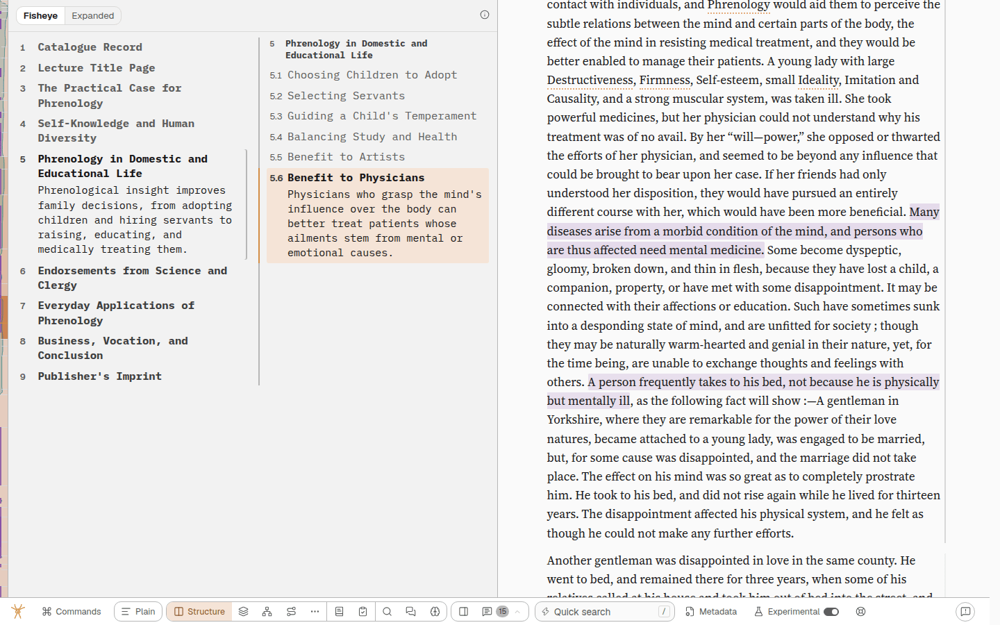
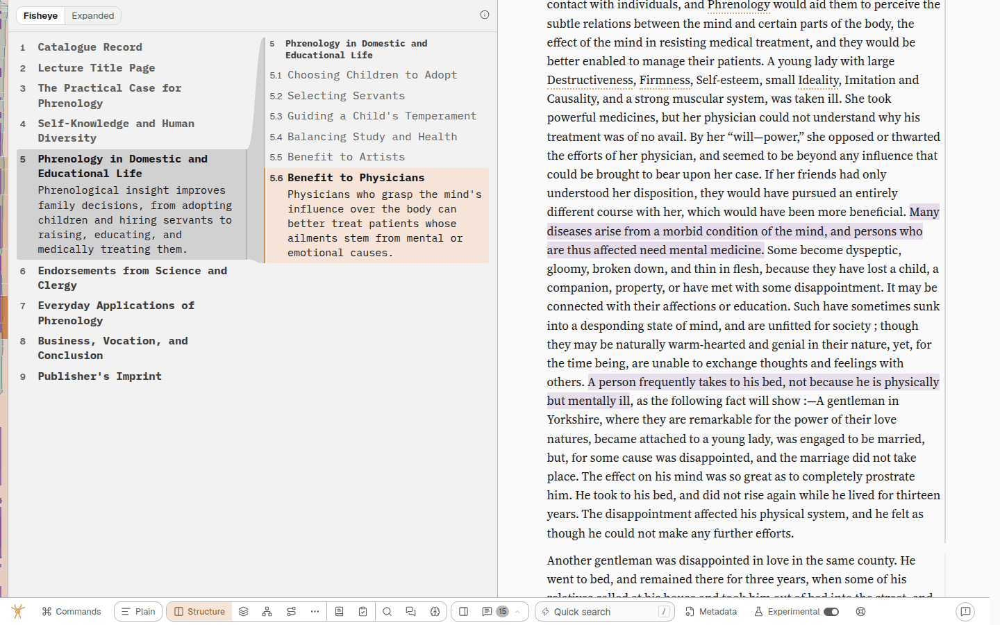
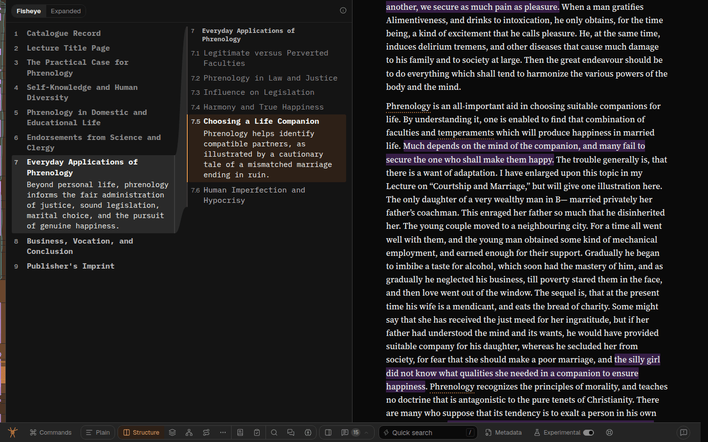
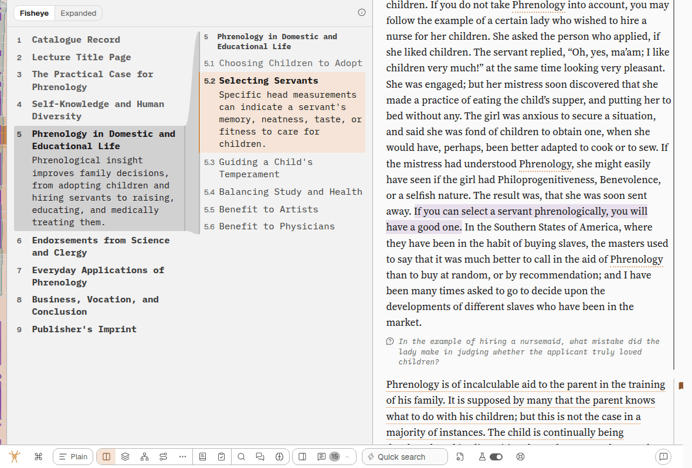

# Structure's two columns: a ribbon from the part to its sections

Up: [structure.md](../project/structure.md) · report `spya-vqpeyr` (#631, SPIDERYARN-READING2-KW) ·
Overseer queue item `qi-3b2xeqck`

> Somehow make it clearer visually in the UI of the Structure mode that the 2nd column is a subset
> of the 1st, kinda like a Sankey diagram. Use screenshots.
>
> — Greg, 2026-10-19, spya-vqpeyr

## The problem

Structure's wide face is two columns: every part on the left (A), the sections of the part the
reader is in on the right (B). What said *B is the inside of that row in A* was three small things:
a 2px grey rule down B's left edge (the "bracket"), a matching 2px inset on the right edge of the
marked row in A, and B's header repeating the part's title. They are the same tint and width, so
the eye was meant to pair them. But they are 16px apart across the gutter, nothing visible joins
them, and the bracket runs the full height of the grid row, ~120px past B's last row in the before
shot. Read cold, B looks like a second list beside the first, not the contents of one of its rows.

The code knew this was the weak point. `StructurePanel.tsx` called the bracket *"the whole of the
connector in v1"* and named what it deferred: *"A drawn taper between two independently measured
columns needs geometry redrawn on every resize and every boundary crossing."* Greg asked for exactly
that taper.



## What we built

**A Sankey link between the columns**: the marked part in A wears a grey ground (the node), and a
band of the same grey curves from that row's full height to the height of everything column B
draws, its header through its last row or counter. It ends in column B's bracket, now only as tall
as column B's content. One row becoming all of that.

```
  column A                         column B
 ┌───────────────┐            ┌───────────────────┐
 │ 1 Intro       │        ╭───┤ 3 Methods         │  ← header
 │ 2 Background  │     ╭──╯   │   Sampling        │
 │░3 Methods░░░░░│░░░░░       │   Measures        │
 │ 4 Results     │     ╰──╮   │ ▌ Analysis  (now) │
 │ 5 Discussion  │        ╰───┤   Limits          │
 └───────────────┘            └───────────────────┘
```

- **Geometry is pure** ([`src/web/structure-ribbon.ts`](../../src/web/structure-ribbon.ts)):
  `ribbonFrom(grid, row, head, list)` and `ribbonPath`. Returns `null` for anything that is not a
  real shape inside the grid: no marked part, no list, zero/NaN/reversed rects.
- **Drawn as an SVG measured off the DOM** (`StructurePanel.tsx` § the ribbon). It is
  `aria-hidden`, `focusable="false"` and `pointer-events: none`, and it is the first child of the
  grid so the rows paint over it. A layout effect reads four rects through `:scope >` selectors,
  because the hidden measuring copies come first and carry a marked row of their own. It re-reads
  on every render, guarded by `sameRibbon` so it cannot loop. It also re-reads when the grid, A's
  list, the marked row, B's header or B's list changes size, and on font load.
- **It cannot move a row.** The SVG is out of flow, and the bracket's border keeps its 2px in the
  box model and is only made `transparent` (`.struct-grid[data-ribbon]`). So it never feeds back
  into the capacity measurement, and layout.ts's width arithmetic is untouched.
- **Grey, never orange.** Fill `color-mix(--rule-strong 55%, transparent)`, shared as
  `--struct-ribbon` by the band and the row's ground so the seam cannot show. The orange wash stays
  on the one deepest row, which is always in column B whenever a ribbon is drawn, and the orange
  thumb moves onto the ribbon's edge (`left: -4px`, held to `RIBBON_EDGE_INSET_PX` by a test).
- **No ribbon** between parts, on an undivided part, before layout, or in the list face and Expanded,
  whose indentation already says "inside". A missing ribbon is the old look.

## The trade-off, and how it went away

A Sankey curve needs horizontal run, and the gutter is 1rem. The first build widened it to 2rem.
GPT Sol's plan review (finding 5) pointed out what that cost: the switch to two columns moved from
1165px to 1181px, one pixel past an 11-inch iPad held landscape (1180px), so that device would have
lost the columns. **Built instead:** the curve runs across the gutter *and* column B's 0.6rem
bracket inset, which the width arithmetic already pays for, and the edge is drawn 4px left of B's
rows. That gives about 24px of curve (Sol's suggested 1.5rem) with **no change to the switch point**:
1180px still draws the columns (screenshot below). Nothing in layout.ts, its test or the docs'
609px / 1165px figures moved.

## Not in this change

- **Hovering another part in A to preview its ribbon and sections.** It would make B change under
  the pointer, a second "where am I"; the row card already previews a part's sections.
- **A second level of flow**, from the current section on to its paragraphs. One level is Greg's
  ask; a second is a second shape on screen.
- **Animating the ribbon** when the reader crosses into another part.

## Simpler options passed over

- **Tint column B's background**, a "zoomed-in panel". Pure CSS, but it says "this column is
  special", not "this column came from that row". The row end is the half that carries the
  meaning, and only a drawn connector has one.
- **A thicker bracket, or an arrow on it.** CSS only, still no visible join to the row. Sol
  (finding 9) agreed neither meets the Sankey ask.

## GPT Sol's plan review

[261020l-…-plan-review-sol.md](261020l-structure-columns-sankey-ribbon-plan-review-sol.md). The
verdict was "revise before implementation". What came of each finding:

1. Scoped selectors, coordinates relative to the grid, rejecting degenerate rects: done, and the
   test gives the hidden copies a conflicting place.
2. Observe the actual endpoints, not only the grid: done (row, A's list, B's header and list), plus
   `onFontsChanged`. The capacity effect also observes its measuring lists themselves and listens
   for font completion; its old loop watched their stretched `.struct-side` wrappers instead.
3. Equality guard: `sameRibbon`, and a comment saying why it is load-bearing.
4. `data-ribbon` on the grid, the border transparent and not removed, the replacement edge at full
   `--rule-strong`, the thumb above it: done.
5. The iPad: the reason the gutter did not move (above).
6. Colour from matched light and dark screenshots: done (below). The shape stops at both columns'
   inner edges, so it never overlays the orange wash.
7. Tests: the pure helper, hidden copies placed elsewhere, a triggerable ResizeObserver redrawing on
   a moved row (seen red by dropping the row from the observed list), a capacity-window change, part
   crossings both ways, font redrawing and effect cleanup.
8. Accessibility: as specified, and asserted.
9. Width separated from the ribbon: yes, the width is now no change at all.

## Evidence

`fowler-phrenology`, local, signed in as the dev admin. 1440×900 light, part 5 of 9 current:



1440×900 dark, later in the piece, where the marked part sits below column B's middle and the band
runs upward:



1180×800, the 11-inch iPad's landscape width, still the columns:



Also checked: 1200×800 and 1181×800 light, and the start of the piece, where the first part is
current and the band's top edge runs flat. The path's ends matched the live rects of the visible
row and column B in every shot (the script printed both).
