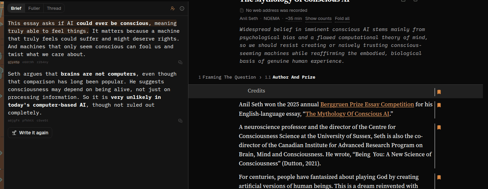
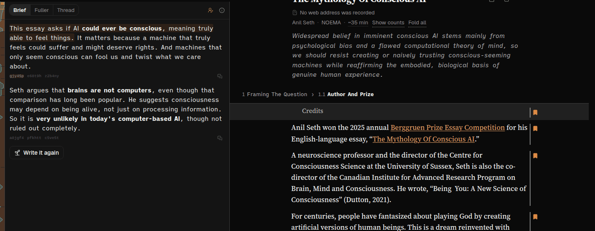
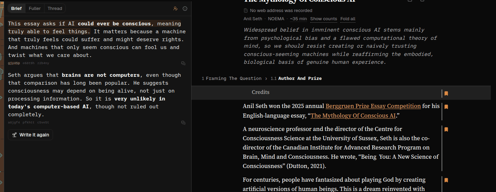
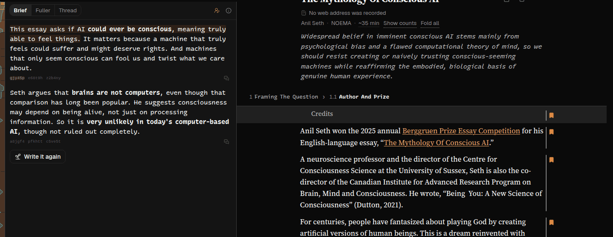
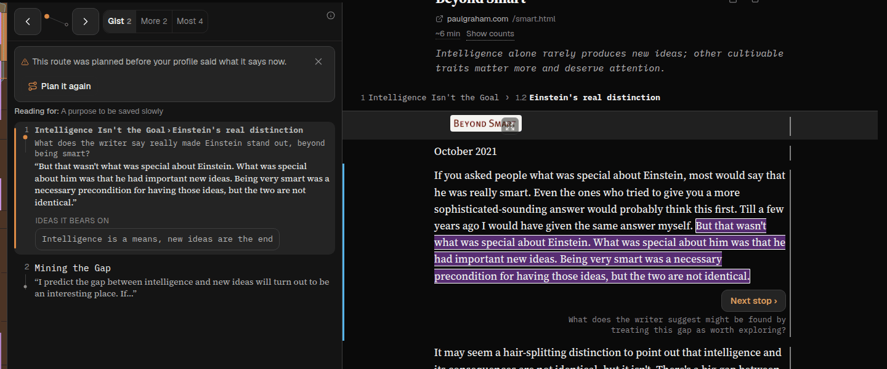
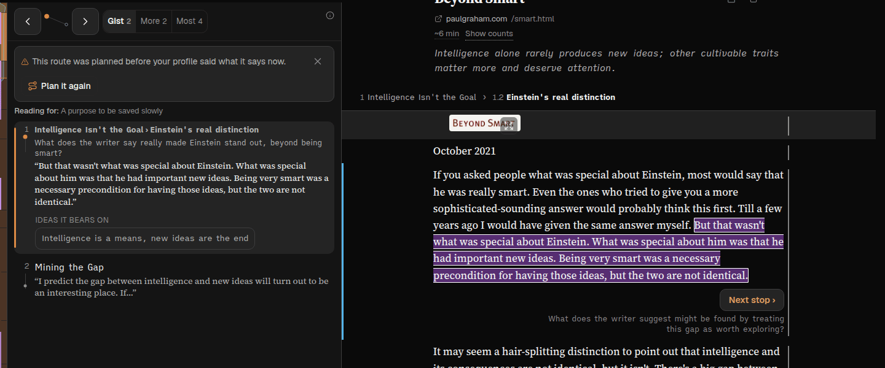
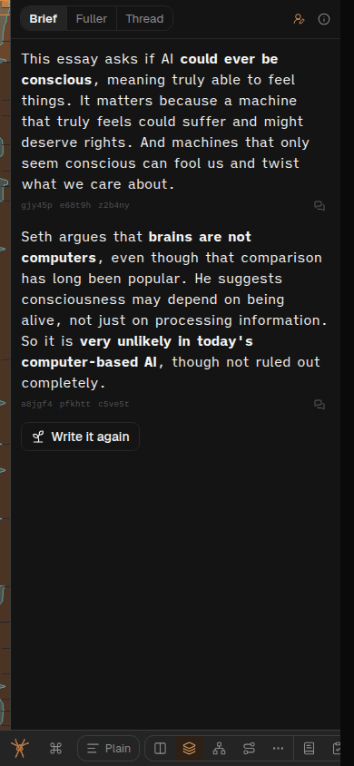

# 261021f — A nicer face for the model's words, and no reader font setting

**Status: in progress.** Follows [261020v](261020v-reader-chosen-reading-fonts.md), which asked Greg
[q-s0suam](../user-feedback/questions/q-s0suam.md). Report `spya-jxwfah` (#653,
SPIDERYARN-READING2-MJ), note
[261019_2133](../user-feedback/261019_2133-reader-chosen-reading-fonts.md). Queue item
`qi-38kzx6pz`.

The reader's words (untrusted data, a reader's report):

> Please can the fonts for the different categories of text be user-definable. I want to be able to
> use other fonts for reading, not just eg times new roman.

Greg's answer, reply `spya-tpq6t9`, 2026-10-20 21:49 UTC:

> Can you make a minimal update that when presenting me with choices, it's helpful to have a bit more
> of a sense of trade-offs. So, for example, I can't tell how complicated this would be. If it's
> trivial, I'd be at least open to it.
>
> That said, I don't think this is the right move. I think really what he's saying, if we read
> beneath the lines, he didn't like the monospace font we're using. So why don't we try finding a
> nicer one, and don't give the user the ability to switch it? Because my hunch is that does add
> complexity that we don't need.

So: **no reader setting**. Change the model's face (`--font-ai`, today IBM Plex Mono) for everyone,
to one that reads better as paragraphs and is still plainly not the author's. Greg has handed the
choice of face to this session.

## Prior work

- [261002b](261002b-a-nicer-ai-typeface-and-the-voices-trawl.md) chose Plex Mono over Courier from
  seven candidates; its research is
  [261002a](../research/261002a-a-nicer-typeface-for-ai-written-text.md), with metrics measured from
  the files. Its runner-up was iA Writer Quattro, "easier to read as paragraphs but barely looks
  monospaced", and fonts.md says the swap is "the token and its import".
- [261020v](261020v-reader-chosen-reading-fonts.md) is the plan that is not being built.
- Nothing on `origin/dev`, in `docs/user-feedback/` or in `gjd-remote ls` touches the AI face since.

## Why Plex Mono tires a reader

A strict monospace gives `i` the same width as `m`, so running text has gaps in it and `m`/`w` are
cramped. That is Butterick's warning about monospace in prose, and it is what a summary of two
hundred words asks a reader to sit through. Plex fixed Courier's thin strokes and small x-height,
not this.

## Candidates

All on Fontsource 5.3.0 under the SIL Open Font License 1.1 (checked with `npm view`, 2026-10-21),
so they are self-hosted like every face we use ([privacy.md](../project/privacy.md)).

| Face | What it is | For | Against |
|---|---|---|---|
| IBM Plex Mono (today) | strict monospace | the typewriter signal at full strength | the gaps above |
| **iA Writer Quattro** | Plex Mono redrawn on four widths (½, ¾, 1, 1½) | Plex's letterforms and slab `i l r` kept, so it still looks typed; the gaps closed; ~10% more words a line | at a glance it can pass for a sans; static 400/700 |
| iA Writer Duo | Plex Mono with only `m M w W` widened | keeps the monospace look; fixes the worst letters | most of the gaps remain |
| Recursive, semi-mono Casual | a variable face with a mono↔proportional axis and a brush-drawn "casual" axis | tunable, warm, true 450 weight | `font-variation-settings` on every AI rule; the file with the casual axis is ~300 KB against Plex's ~15 KB |

The test is the one Greg set for the voices: an AI paragraph next to the author's serif, the
reader's Arial and Geist chrome, and each must still be told apart at a glance — in Skim, where the
report came from, and in Summary and chat, where the paragraphs are longest; dark and light; laptop
and a 390px phone.

**Expected pick: Quattro**, unless the screenshots say it blurs into Geist. It is the change that
answers the complaint (paragraphs that tire), keeps the letterforms that made Plex read as
machine-made, costs one package swap, and needs no new mechanism. Weight handling stays as now
(static 400/700, dark mode's 450 resolves to 400; fonts.md).

## The change

1. `package.json`: `@fontsource/ia-writer-quattro` replaces `@fontsource/ibm-plex-mono` (if Quattro
   wins); the four imports in `src/web/tailwind.css`; the `--font-ai` token in `styles/tokens.css`
   (family name checked against the package's CSS, since Fontsource's names are not always the
   obvious one); stale comments naming Plex (`summary.css`, `voices.css`, `tokens.css`).
2. Docs: fonts.md's table and its "how chosen" line; typography.md and design-css-overview.md where
   they name Plex.
3. A test that the token names a family some imported `@font-face` actually declares, if nothing
   checks that today — a misspelt family falls through to Courier New silently, the failure the
   tailwind.css comment already warns about for Geist.

Not changed: which elements are in the AI voice; Sketch's SVG labels (still unvoiced, fonts.md);
`evals/arc-length/run.ts`'s estimate, which records the face at the time it ran.

## The rule-doc line

[ask-me-questions.md](../reusable/ask-me-questions.md) § How to ask, under "Then each option": a
rough size for building each option, quoting Greg. A rule doc, so minimal and with his words.

## Simpler option passed over

Leaving Plex Mono and declining the report. Greg asked for a nicer face, so that is not on the table.
The reader setting from 261020v is the more complex option, declined by Greg.

## Stages

1. Specimens and screenshots (Sonnet subagent, Playwright): the candidates in the real app. Pick.
2. Build the swap, the test (red first), docs; gates; GPT Sol code review; commit.
3. Rule-doc line, q-s0suam, the note, `feedback-endings.ts`, push, queue item done.

## Progress
- 2026-10-21 — **GPT Sol, plan review** ([answer](261021f-plan-review-sol.md)): *approve with
  changes*. Taken: (1, P1) code in a model's answer is in `--font-ai` today (`voices.css`), and
  Quattro's four widths would misalign code — so code gets a strict monospace of the same family,
  **iA Writer Mono** (OFL, `@fontsource/ia-writer-mono`), as a second token `--font-ai-code`, and
  stays in the model's voice; (3) the real cost, ~44 KB per style used against Plex's ~15 KB
  latin subset, in exchange for Greek, Cyrillic and Vietnamese in the one file; (4) check
  Marginalia's arc clamp, Thread width and Skim's cue size, and refresh the rationales that say
  "monospace"; (5) the family test covers every self-hosted primary token and the four styles;
  (6) the inventory. Not taken as written: (2) the rule-doc edit's approval gate — Greg asked for
  this exact change in `spya-tpq6t9`, and the brief from the admin says to make it, minimal and
  quoting him; the before and after are shown in the report.
- 2026-10-21 — **screenshots** (Sonnet, Playwright, dark and light, 1440 and 390px; Skim on
  `smart-spya-fq4q5h`, Summary on `noema-mythology-of-conscious-ai`; chat had no existing thread to
  show, Tweets and Marginalia not shot). All four faces loaded and computed; no horizontal overflow
  at 390px in any. **Picked: iA Writer Quattro.** The subagent preferred Duo, as the safer step from
  Geist; I did not, because in the shots Duo's paragraphs are nearly indistinguishable from Plex's,
  so it would not answer a reader who found the monospace hard going. Quattro reads as prose and is
  plainly not the serif; at small sizes it is nearer Geist than Plex was, told apart by its letters
  (the wide `i`, slab `l`) rather than its spacing. Recursive's casual letters looked playful, for
  a heavier file and a variation-settings rule.

  
  
  
  
  
  
  

  The rest: `261021f-shot-skim-{duo,recursive}.png`, `261021f-shot-summary-*-light.png`,
  `261021f-shot-summary-plex-phone.png`.
- 2026-10-21 — **built**: `@fontsource/ia-writer-quattro` and `@fontsource/ia-writer-mono` replace
  `@fontsource/ibm-plex-mono`; `--font-ai` and a new `--font-ai-code`; a code rule in `voices.css`
  that ties with the AI list and comes after it, so the list's specificity is unchanged; the stale
  "monospace" rationales (Skim's cue, Marginalia's clamp, summary.css, typography.md); fonts.md;
  /design's token table. New `tests/self-hosted-faces.test.ts`: red when the token is misspelt
  (`'iA Writer Quatro'`: three failures) and when the 700 italic import is dropped (one failure).
- 2026-10-21 — **GPT Sol, code review/fix** ([answer](261021f-code-review-sol.md)): *approve after
  fixes*. Fixed in-stage: `voices-css.test.ts` still counted five voice rules (now six), plus a
  full-cascade test that code in chat and Candidates answers resolves to `--font-ai-code` and other
  code stays `--font-mono`; iA Writer Mono's italics imported (emphasised inline code would have
  been synthesised), with the style test widened, red first; two stale lines in fonts.md. Sol
  confirmed the cascade: both rules 0-4-1, the code rule later, beating mode-band.css's 0-3-1.
