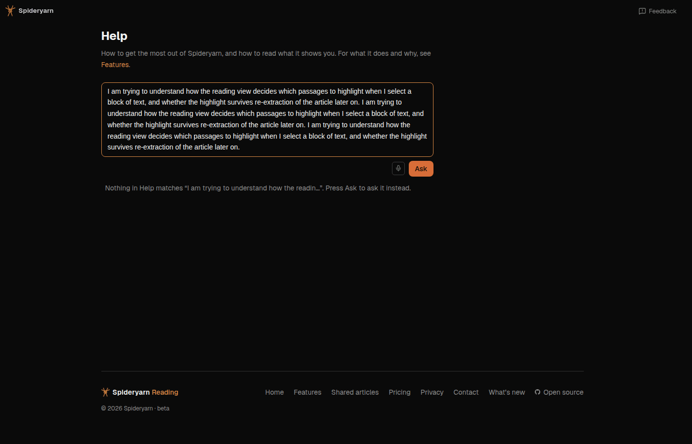

# Help's box grows with its words, and what a history of questions would cost

Two suggestions from Greg on `/help`, 2026-10-23, both admin (`feedback-reporter.ts` exit 0, no
addenda). Session `fbp8h7r3-help-input-and-history`.

> The input box for when I ask a question doesn't seem to expand. It stays pretty small. I think it
> should get larger.
>
> — Greg, #680 `spya-p8h7r3`

> It might be nice to be able to see previous questions I've asked of the help. I don't think this
> is super important though, so if it adds a lot of complexity, then we can skip it. But in an ideal
> world, the help would have a sort of, I don't know, a tab or something for previous questions, and
> obviously their answers as well. And obviously, you know, each user would only be able to see
> their own. And it would have to show the date as well.
>
> — Greg, #681 `spya-jyjph5`

## #680: the box grows

Help's signed-in box (`HelpAsk.tsx` § `AskBox`) was a `rows={2}` textarea with `resize-y`: two
lines, then a scroller inside it, unless you found the drag handle. The house answer to "a box as
tall as its words" already exists and is shared — `src/web/useFitTextarea.ts`, used by the Feedback
reply box, the add page's two boxes and Quiz's answer box. So:

- `useFitTextarea(box, value)` in `AskBox`. `rows={2}` stays the floor. No roof, like the other
  users of the hook. A 1,000-character question of prose is about 30 lines in the narrow column;
  Shift+Enter could make it hundreds, which we accept (GPT Sol's plan review, F1, corrected an
  earlier "a few hundred pixels"). Either way the box never scrolls itself: on `/help` and on a
  phone the page scrolls, and beside a page at `lg` the sticky column (`HelpPage.tsx`, the `aside`
  with `overflow-y-auto`) is the scroller the box sits in.
- **And empty, the rows decide** — in the shared hook, not only here (Sol's F2). An empty
  textarea's `scrollHeight` counts its placeholder in Chrome, which Chat's composer already guards
  against; `useFitTextarea` did not, so every caller with a placeholder that wraps could open
  taller than its rows. Now an empty box clears its inline height.
- `resize-y` becomes `resize-none overflow-hidden`, as `.fb-reply-input` has: a drag handle would
  fight the fit (the next keystroke resets it), and the hidden overflow keeps the one-scroller rule.
- Test first: `tests/help-one-box.test.tsx` § grows with its words — red before, green after.

**Passed over:** CSS `field-sizing: content` (two boxes use it). It is one line, but no Firefox and
iOS Safari only from 26.2, which is why `useFitTextarea` exists; the help box is used on phones.
Also passed over: Chat composer's roofed fit — Chat's box sits above a transcript it must not push
off screen; Help's sits above an answer and a list that scroll with the page.

## #681: a history of your questions, not built, and why

**What is stored today: nothing that could show a history.** The question and the answer are
neither stored nor logged; what is kept is the allowance's row (who asked, and when) and the call's
cost (help-page.md § Ask about Spideryarn). And **the public privacy page promises it**:
*"the question is not kept, and is not written to our logs"* (`PrivacyPage.tsx`, the models
paragraph; privacy.md § A question asked in Help; `tests/privacy-page.test.ts` holds the clause).

**What it would take**, at its simplest:

1. A table (owner, question, answer, whether it finished, asked-at) and its migration, owner-scoped,
   deleted with the account.
2. The save, in `streamHelpAnswer` — and not simply after the stream's `done`, because a reader's
   Stop only aborts the browser's request and `askHelp` then returns without a `done` (Sol's F3).
   So a row inserted before streaming and settled afterwards, and a decision on whether a Stop, a
   closed tab, a dropped connection and a failure are kept, and how each is marked.
3. A read route for the signed-in reader's own rows, newest first, paged or capped.
4. A *Your questions* tab or list on `/help`, with dates, drawing each saved answer through the same
   untrusted-answer path (`CitedMarkdown`, the Help-only link allowlist).
5. A delete — one row, or all — since we would now be keeping a reader's words they never had a
   reason to think were kept.
6. Rewording the public privacy page (and `LAST_UPDATED`), privacy.md, help-page.md, the privacy
   test, and whether the export includes it.

That is a dozen or so files — the schema, a migration, the store's contract, its Postgres
implementation and wiring, the route and its shared response shape, the client, database, route and
UI tests, then the privacy page, its test and three docs (Sol's F4 counted the plumbing an earlier
"six or seven" left out) — with two product choices inside it (keep forever or for N days; what an
interrupted answer saves), and two GPT Sol reviews. Roughly a day of agent work. Step 5 could wait
for a first version, with account deletion and the existing data-rights route standing in.
Nothing stored today makes it cheaper: `rate_limit_events` holds owner, bucket and time and is
swept, and the cost ledger holds no prose by design. Against *"not super important … if it adds a lot of
complexity, then we can skip it"*, it is not modest, so **#681 ends Declined for now**, with this
cost in its note. If Greg wants it, the list above is the plan's skeleton.

**A cheaper half considered and passed over:** keep the history in the browser (`localStorage`). No
migration and no privacy change, since nothing leaves the device — but it would be per-browser, not
per-reader (gone on another device, shared by two readers of one browser unless keyed and cleared on
sign-out), which is not what Greg described, and it would still need the tab and the untrusted
drawing, and the privacy page would still change, since it lists what the browser keeps. Half the
work for a feature that does not do the thing asked.

## Reviews

- Plan: [261024e-help-box-plan-review-sol.md](261024e-help-box-plan-review-sol.md) — four
  findings, all taken: F1 and F2 above, F3 and F4 into the #681 costing. Sol agreed "Declined for
  now" is fair.
- Code: [261024e-help-box-code-review-sol.md](261024e-help-box-code-review-sol.md) — no findings,
  no edits; it audited every `useFitTextarea` caller against the empty-box change.
- Browser (Sonnet, Playwright, this worktree's server, no question sent): empty 60px at 1400px on
  `/help` and `/help/spine` and at 390px; 600 characters grew it to 151, 401 and 287px with nothing
  scrolling inside; emptied, 60px again; no console errors.
  
