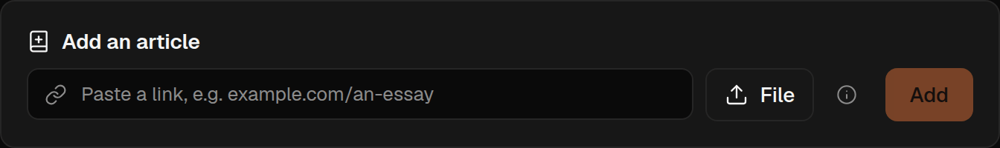

Paste a web address into **Add an article** on your shelf and press **Add**. You can leave off the
`https://`. To add a file, press **File** or drop one on that box: a PDF, a web page you saved as
HTML, a Word document (`.docx`), or a Markdown (`.md`) or plain text (`.txt`) file. Pictures in a
Word document are left out for now; its words, headings, lists and tables come in. One file is
read in full. Choose several at once and each is added with only its title,
authors and abstract read; open one and press **Read this** when you want the whole of it.

You can also add a page from its address: go to `/add/` followed by the full URL, for example
`spideryarn.com/add/https://example.com/essay`. That makes a bookmarklet easy.

Some sites turn Spideryarn away but let you in. For those there is **Save for Spideryarn**, a
bookmark that saves the page you are looking at as a web page file, which you then upload. You find
it under the upload button when an article fails to come in for that reason: drag it to your
browser's bookmarks bar (on a computer; phones and tablets usually have no bookmarks bar). On the
article's page, click the bookmark, then upload the file it saved.

It saves the page as you see it, so anything personal on it, such as your name in the site's menu,
comes too; it leaves out the page's scripts and what you have typed into its boxes. The file itself
is kept for you alone, even if you share the article. Its pictures may not come through, because
they are fetched from the same site that turned us away.

While an article is coming in, you see each stage tick past. **Keep a Spideryarn tab open until it
finishes**: the work is driven by your browser, and if you close every tab it pauses until you come
back. Adding sends the text to an AI provider to be processed.

Press **Stop** to give up on an article that is taking too long or you no longer want. Stopping
early on, before the piece has a readable draft, abandons it. Stopping once it is nearly done keeps
whatever that last stage produced and brings the article in as far as it got.

When it goes wrong, the message says why. What to try:

- **Not enough readable text** usually means a login wall, a paywall, an error page, or a page that
  fills itself in with scripts. Trying again gets the same page. Instead, open it in your browser.
  Use the site's **Download PDF** button if it has one; otherwise save the page as a PDF. Then
  upload that file.
- **A PDF that is locked, damaged, too big or too long**: upload a copy without the password, a
  smaller file, or just the part you want.
- **A stage stopped part way**: press **Retry**. It skips the stages that already worked.

An article counts against your allowance only once it comes back readable; a failure costs nothing.
See [Plans](/help/plans).
