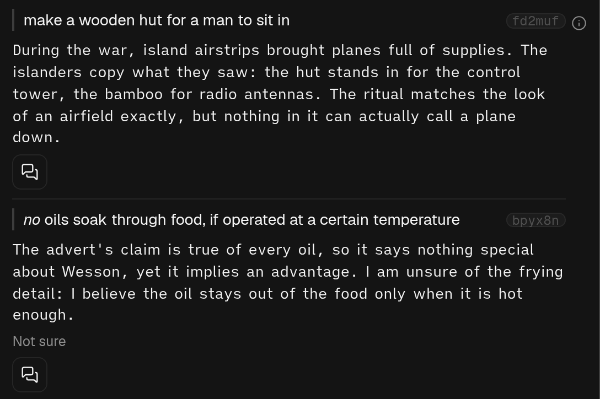

## In short

Most pieces have a few places where a reader gets stuck: a step the author skips, a move whose point
is never said, background they assume you have. Explanations finds the places this piece is likely
to trip you up, given what you have told us about yourself, and puts a short explanation of the
missing piece beside the passage. The passage stays the author's; the explanation sits next to it,
never in its place.

## When to use it

On a piece from outside your field, or a dense one, before or while you read it. It is not a
summary and not a glossary: a single unfamiliar word is Glossary's job, and this is for the steps
between the words. Only whoever added the article can make or see its explanations.

## Reading it

- The quoted words are the article’s own, checked against it. Press the passage’s short code to jump
  to it in the text.
- **Not sure** means the AI was unsure of its own explanation, and the explanation says what it is
  unsure of.
- **Draws on AI memory, unchecked** means the explanation leans on something the AI knows from
  outside the piece, which nothing has checked.
- The chat icon asks about that passage in Chat, with the explanation in the question.
- “Nothing in this piece looked likely to trip you up” is a real answer.
- With Marginalia on, each explanation is also a line in the margin beside its passage.
