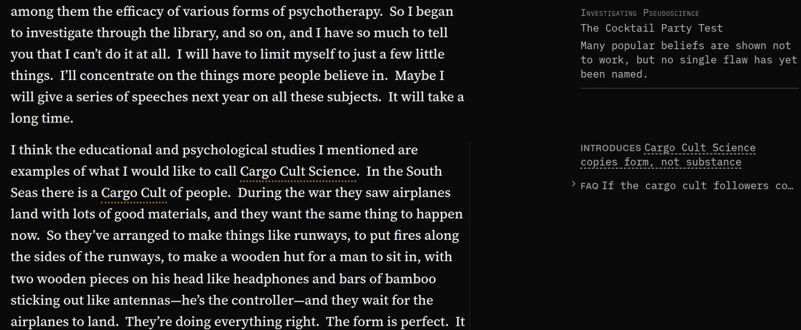

## In short

Good readers write in the margins. Marginalia puts notes in a column to the right of the text, each
beside the paragraph it is about: a question for each part, a mark where an idea turns up, and
*so*, *but* or *vs* where the argument turns. It may also add a few short explanations, reminders
or tensions between passages. It is a switch rather than a mode you change to, so it can stay open
beside whatever else you are doing.

## When to use it

While you read, as a quiet companion. Unlike the other modes it is a switch rather than a choice:
the **Marginalia** button sits at the right-hand end of the modes in the bottom bar, and its column
can stay open beside any other mode’s panel. It is sparse on purpose — one question per part, and a
mark where an idea occurs. In a narrow window it tells you so, and if another mode’s panel is open,
pressing **Marginalia** again swaps the notes in for it.

## Reading it

- **A question with a thin line beside it** is the question that part of the article answers; read
  on to find the answer. There is one for each part, beside its first paragraph.
- **“assumes …”** marks an idea the piece takes for granted; **“introduces …”** one it puts forward
  and argues for. Each sits beside the first passage where the idea occurs; point at it or tap it to
  read the idea in full. These appear only once [Ideas](/help/mode-ideas) has been made.
- **Other modes’ lines**, shut by default: saved FAQ questions, dated Timeline events, Sources’
  claims and cited works can appear beside their passages, as can your comments. A line shows one
  item or a count; press it to open it.
- **Note, Recall or Tension** is a short AI-written note. Recall and Tension link to the other
  passage they refer to; press the link to go there and check its words.
- **Origin** says where a quotation, an allusion or a name in the passage comes from, when the
  article does not say. It is written from the AI's memory, not from the article, and nothing has
  checked it, so it is marked *AI memory, unchecked*: treat it as a lead.
- **Cites**: point at the line to see the same card a citation in the text shows, with who wrote
  the work, its entry in the references and every passage that cites it. Opened, it can also show a
  short note on what the cited work says, written by AI from the work's abstract and checked
  against it.
- **Challenged, Supported, Since, Citation?, Not cited? or Reception** is what a search of the
  literature found about the passage, once it has run in [Sources](/help/mode-sources) › Where it
  sits. The first time you press **Marginalia** to turn the notes on for an article, that search
  starts by itself if it has never run; its findings appear in the margin a few minutes later. A
  reload or a link that opens the article with the notes already on does not start it.
  Opened, it shows the AI's note on each finding and the pages it rests on; **Open in Sources**
  shows the finding in Where it sits.
- Point at a line that is cut short to read the whole of it.
- The top of the column shows where you are, and where the argument has got to.
