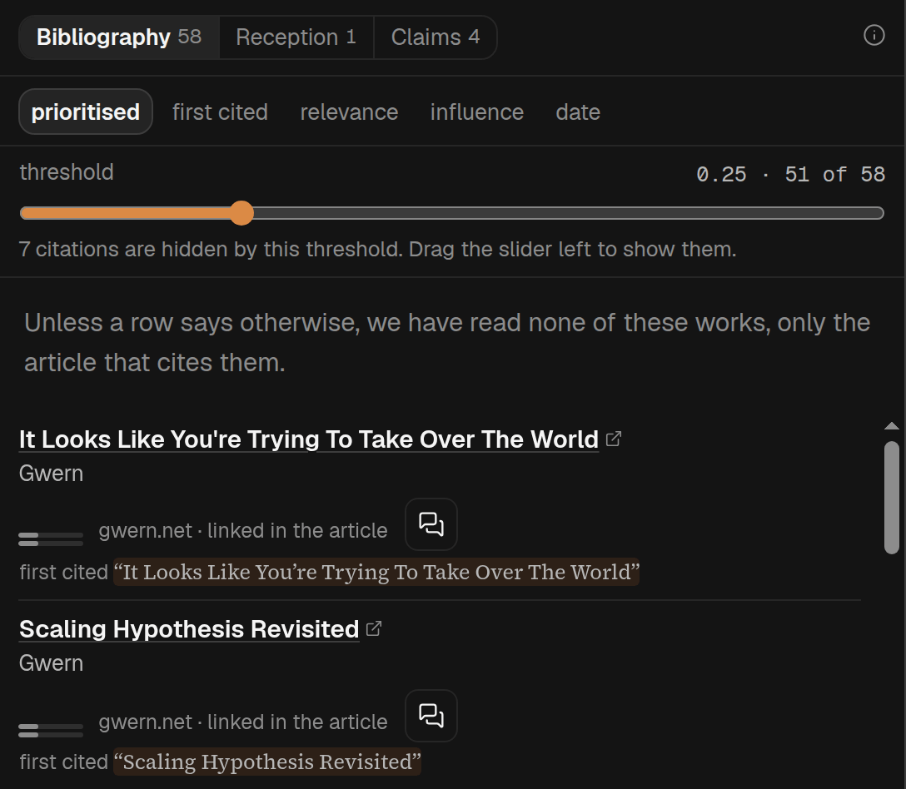
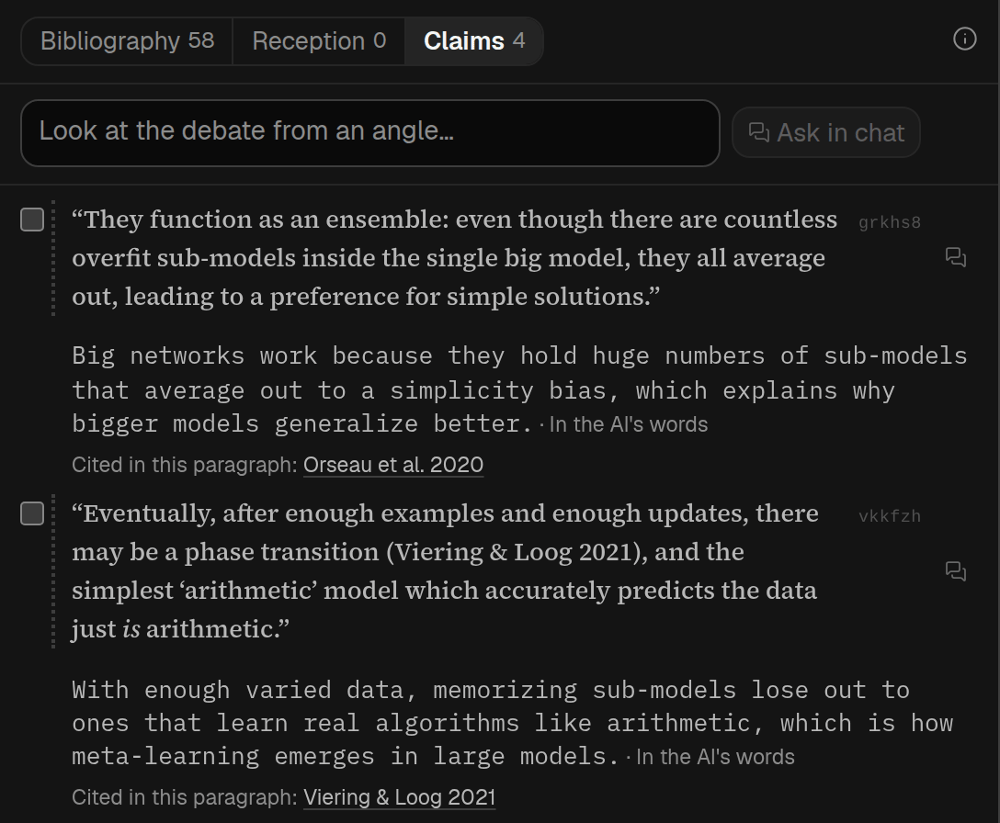

## In short

A piece sits among other people’s work: the works it builds on, and what others have said about it
since. Sources shows both. **Where it sits** opens first: the papers that have cited the piece since,
the works it leans on most, and a search of the wider literature at one press. **Bibliography**
lists everything this piece cites, with a link for each, and **Links** every web address the piece
itself links to. Under Where it sits are four tools: **Pages about it** (what others say about the
piece itself), **Check a claim** (the claims it rests on, to check against the web), **Close to it,
not cited** (papers close to it that its bibliography does not list), and **Ask your own question**
(questions about all of it to put to [Chat](/help/mode-chat), which searches the web to answer).
Every source links out, so you can check it rather than take our word for it.

## When to use it

For an academic paper or a report, where the questions are “what is this built on, and where do I
find it?” and “what have others made of it?”. Three buttons at the top choose the view: Where it
sits, Bibliography and Links; the number on Bibliography and Links is how much each has to show.
Bibliography is usually prepared in the background when the article is added; if it was not,
opening Where it sits or Bibliography makes it, at no charge to you. Nothing else is made by opening
a view: each tool has its own button for that, such as **Search the web** in Pages about it or
**List its claims** in Check a claim, and the search of the literature is its own button in Where it
sits. Whatever is made is kept. The web search behind Pages about it takes about a minute, and often
finds nothing, which it says plainly, because many pieces have no reception at all. A link or Back to
a view never starts anything. Only whoever added the article can make these; visitors to a shared
article see Bibliography, Links, Reception and Claims, with what has already been made.

Sources used to be two modes, Citations and Debate, and was briefly called Peer review. Old links
to any of them still open the right view. If you have been asked to review a paper yourself, [Referee](/help/mode-referee) is the mode
for that.

## Reading it

**Where it sits**

- A line at the top says how old the piece is, when we know: for an older piece, what has been said
  since; for a recent one, where it sits now.
- **Search the literature** is one press. Over a few minutes an AI plans a dozen or so web searches
  from the piece, reads what they find and the later papers that cite it, and lists the passages
  later work challenges, supports or has moved on from, each with its sources and what they say,
  checked against the source’s own words. Its press sends the piece to an AI, sends the searches
  that AI writes to a web search engine, and sends its DOI or title to a public index of papers; the
  line under the button says so before you press. Finding nothing does not mean there is nothing.
  Once it has run, its findings come first, and its own questions appear in Ask your own question as
  **Suggested for this piece**. A finding’s chat icon asks about that finding in
  [Chat](/help/mode-chat); the chat goes back to the finding. Only you see any of it.
- **After it** lists the papers that cite the piece, most cited first, from OpenAlex, a free public
  index of published work. It is the same list as Cited by in Pages about it. No AI is involved, and
  we have not read what those papers say about the piece.
- **Before it** lists the works the piece leans on most, as Bibliography rated them. Press one to
  open its row in Bibliography.
- For an older piece, After it comes first; for a recent one, Before it; with no year, side by side.
- **Tools** at the foot open the other four views. Opening one starts nothing; inside, **Where it
  sits**, at the top beside the view's name, brings you back.

**Bibliography**

- The **(i)** at the top of the band says we have read none of those works, only the article that
  cites them. A row says more only when that changes: a page found for it, a search extract read, or
  the paper itself read. The sentence on what the piece uses a work for is written from the article,
  not from the cited work.
- Many rows have a **short note** under the authors: a sentence or two an AI wrote from that work’s
  abstract alone, looked up in a public catalogue of papers (Crossref, DataCite, or OpenAlex). It is
  not a web search and not a reading of the paper, so it can be wrong. Under it, *From the abstract ·
  Crossref* (or wherever it came from): point at those words, or tap them, to see the day it was read
  and the words of the abstract each sentence rests on. A work with no note had no abstract we could
  be sure was its own, or its note did not pass our checks; that says nothing about the work. Notes
  are written by themselves a minute or so after the list, for every work at once, and visitors to a
  shared article see them too.
- **A work with no note can get one from the web.** Point at a citation in the article and press
  *Open in Sources* on its card: we search the web once for the work’s page, and an AI writes a
  sentence from the search engine’s extract of that page, which code and a second check hold to the
  page’s own words. Its DOI page or its arXiv page is its own, and the note is labelled *From a web
  search ·* and the site. Any other page counts only when its title names the work and its title or
  extract names the work’s first author — a publisher’s page, a library record, an author’s own
  copy. Code refuses Wikipedia, Goodreads, Amazon, one review journal and a short list of summary
  sites, but elsewhere the page can still be someone else’s catalogue entry, blurb, review or
  encyclopedia entry. That is why the note says *may not be the work’s own page*. A web page can
  say more or less than the paper, so either can be wrong. While it looks, the row says so. If no page passed, the row says
  that, and it is not searched again for a week. A work with no DOI or arXiv id is searched by its
  title and first author only when the article came from a web address; in a file you uploaded it
  is not searched. Only you see these notes, not visitors.
- Two small bars: **relevance** to this piece, and **influence** in its field. Influence is the
  model’s memory of the work, not a citation count. New lists give a number only when the model is
  confident it knows the work; a low number then means a work it knows and thinks minor. If
  relevance was scored but influence has no usable score, the row says *influence unknown*. Older
  lists keep their numbers, including low scores that could mean the model did not know the work,
  until regenerated from Metadata.
- A row’s influence bar marked *from the web* was read from a web page about the work by an
  earlier web search on that row; point at those words, or tap them, to see the site, the day and
  the page’s own words. It is an AI estimate from web evidence, not a citation count, and the page’s
  words may be about something else on that page.
- Some rows also say something like *cited 357 times · Crossref*. That one is a real count, not the
  model’s view: Crossref is the registry that issues most DOIs, and where the article gives a DOI
  that Crossref holds, this is its own number for the work. Point at the words, or tap them, for the
  day we read it; it is not refreshed after that. Crossref only counts citations from works whose
  publishers have sent it their reference lists, so the number is usually lower than Google
  Scholar’s, and it should not be compared across fields or between an old work and a new one. *no
  citations recorded* means Crossref has none on file, not that nobody has cited the work. Most rows
  have no count, because most works are cited without a DOI. It sits beside influence and does not
  change the order or what the slider hides.
- The **chat icon** opens a new conversation in [Chat](/help/mode-chat) and asks a question about
  the work straight away, with the work named; if one exists, it reopens that instead. Chat can search the web and your library to answer,
  and you can go back and forth. It is on the row, and on the card you get by pointing at a
  citation in the text. A longer reading kept on a row from before (once made by a button called
  **Dig deeper**, which has gone) is still shown there. Once you have asked, the button becomes a
  line with the chat's short summary; press it to open that conversation again beside
  Bibliography. The conversation is also in Chat’s list, marked *Bibliography* beside Sources’ icon. Only
  whoever added the article has this.
- **Does it say that?** is on the card you get by pointing at a citation in a paragraph. It opens
  a new chat beside that paragraph, asking whether the work says what the paragraph
  cites it for. Chat then tries to read the work itself: it can when the article gives a DOI or
  arXiv link to a freely available PDF, and it checks the PDF is that work before reading it. It
  says what it read, and says so plainly when it could not read the work. You do not have to press
  it: rest the pointer on a citation (or tab to a linked one) and, after about two seconds, the card
  asks this by itself and shows the answer in the card, with **Continue in Chat** to carry on. It
  happens only when the card names one work, never from a tap on a phone or tablet, and only once
  for each work and paragraph: rest there again, or press the button, and you get the same chat. An
  answer takes about 20 seconds. There is a daily limit on the automatic ones; past it the card
  says so, and the button still works. Only whoever added the article has this.
- **first cited** jumps to where the article first cites it. *only in the references* means the
  article lists it but never cites it in the text.
- **In your library** or **On the public shelf** means the work is already an article here, and
  links straight to it.
- Once the list exists, the places a work is cited are underlined with a dashed line in the text, in
  every mode. Point at one, or tap it, to see the work.
- Orders: **prioritised** (the default, with a slider), **first cited**, **relevance** and
  **influence**. The slider hides the works that score lowest on relevance and influence together,
  relevance counting double; a work whose influence is unknown is judged on its relevance alone
  when available. Ordered by influence, the unknown ones come last, the most relevant first.

**Close to it, not cited** (Not cited)

- Papers close to this piece that are not among the works Spideryarn found in its bibliography,
  closest first. Nothing is searched until you press **Search OpenAlex for related work**, which
  sends the piece’s title and the opening of its text (its abstract, on a paper) to OpenAlex, a
  free index of research papers, and nothing else of the article. No AI is involved. The answer is
  kept, so the list is there next time; **Search again** asks afresh.
- Each paper is checked against the bibliography by DOI or arXiv number, by title, and by the
  article’s own reference text, and left out if it matches. A paper the piece only mentions in its
  text can still be listed, and if the bibliography was made from an older version of the piece, or
  leaves some works out, the list says it may include works the piece does cite. Whether any of
  them belongs in the piece is yours to judge.
- Each row is the paper’s title (press it to open the paper in a new tab), its authors, year, venue
  and how often it is cited, and the opening of its abstract, so you can see why it came up.
- Only whoever added the article has this view, and it needs Bibliography first.

**Links**

- Every web address the article’s own text links to, one row each, in the order you meet them in
  the piece. Each row is the article’s words for the link, then the site it goes to (and a DOI or
  arXiv number when the address carries one), then the paragraphs that link it, each a jump to that
  paragraph. Press the words to open the page in a new tab.
- It is read straight off the article in your browser: no AI, no search, and nothing is fetched, so
  it is there as soon as the article is and costs nothing. Links to another part of the piece,
  footnote markers, and links with no words of their own (around a picture) are left out.
- **In Bibliography**, on a row, means Bibliography lists a work at that address, or the same paper
  at another address; press it to open that work’s row.
- An article read from a PDF has no links of its own: its addresses, if any, are in Bibliography.

**Pages about it** (Reception)

- Nothing is searched until you press **Search the web**, about a minute of searching that is kept.
- What others have written about this piece itself: replies, reviews, and work that cites it and
  says something about it. The AI's sections and **Cited by** start folded, so you see their outline
  first; press one to open it. **Every page** starts open, so no source depends on a press.
- **What the AI noticed in these sources**, at the top, holds **Key sources** (the ones the AI
  thinks matter most, starred) and the themes several sources share, each with how many sources
  are in it. A source can be in more than one.
- **Every page**, open from the start, lists every source found. Pages that link to the piece or
  quote it come first. Pages that only mention its title follow under **Mentions its title only —
  may be another piece**: often a paper citing it, sometimes a page about something else with the
  same title, so check before you rely on one. Each source is two lines: its title, then the site,
  the year and one word of the AI's reading. Press the arrow beside it for the quoted excerpt, the
  AI's full reading, and how we know the page is about this piece.
- **Cited by**, at the end, lists the papers that cite the piece, most cited first. It is free and
  is there before you search: it comes from OpenAlex, a public index of published work, which we
  ask using the piece’s DOI, and no AI is involved. It is a list only: we have not read what any of
  those papers says about the piece. When the piece has no DOI on record, we look for it in
  OpenAlex by its title instead, and list its citers only if the record's title and authors (or an
  author and the year) match; the list then names the record it matched, so you can check it. Only
  whoever added the article sees it. **Search Google Scholar**, under it, opens a search for the piece’s
  title.
- To ask about the piece from an angle of your own, use **Investigate** (below). The box that was here has
  moved there.
- Reception can be ordered **as found**, by **date** or by **stance** (most critical first); the
  order applies inside every section.

**Check a claim** (Claims)

- Press **List its claims** to make the list the first time, with one AI call over the piece and no
  web search; opening the view makes nothing. Each claim is quoted in the
  piece’s own words, with a link to that passage, and under it a short line in the AI’s words. If
  the piece changes afterwards, the list is shown with **List again**. The number on Claims is how
  many claims are listed, or, once you have checked some, how many sources the checks found.
- Under a claim, **Cited in this paragraph** names the works the piece cites in the same paragraph
  as the claim, once Bibliography has been made. Press one to open its row in Bibliography, with its
  link. It only means the work is cited near the claim: it does not say the work supports it, and a
  work the piece cites many times may be missing from a later paragraph.
- To check claims on the web, tick up to four in the list, or type one of your own in **Check a
  claim of your own**, and press **Check**. That is one web search over all of them together, takes
  about a minute and a half, and costs real money; nothing is searched until you press. The sources
  it finds appear under each claim, with your own claim after the list. **This search found nothing
  it could quote on this claim** is a real answer. If the search did not answer for a claim at all,
  it says so in different words, and you can check it again. **Dig further**, beside a claim that
  has been checked, runs one more search for that claim alone and looks for sources it has not
  found yet. One check runs at a time per article, and there is a limit on how many web searches you
  can ask for in an hour and in a day. Visitors see the list, not the checks or anything you typed.
- To look into one claim yourself, press the chat icon beside it. It opens a new conversation in
  [Chat](/help/mode-chat) and sends a question with the claim quoted; if one exists, it reopens that
  instead. Once you have asked, the icon becomes a line with the chat's short summary; press it to
  open that conversation again. Only whoever added the article has this.
- A search made before 2026-10-08 also picked three or four claims by itself and searched those;
  it still shows them, under **Claims the earlier search chose**, each with the sources on it.
  Press a claim to fold its sources away. The **relevance** slider hides sources the AI judged to
  bear on their claim only loosely or partly.

**Ask your own question** (Investigate)

- Questions about the piece and what others say about it, each answered in a new conversation in
  [Chat](/help/mode-chat), which searches the web. A press sends the question straight away, and
  costs one chat answer; opening Investigate, or coming back to it, sends nothing.
- **Suggested** questions are the same for every piece: how it has been received, whether its main
  claims are borne out, who disagrees with it most, whether the studies it leans on have held up,
  and what has been published since.
- **About its claims** asks about up to four of the claims in Claims, once that list has been made
  (Investigate never makes it). **About the works it cites** asks about the three works Bibliography says
  the piece leans on most. These are the same conversations as the chat icon in Claims and
  Bibliography: one already started shows its short summary instead, and opens it again.
- Or type your own question in the box at the top and press **Ask in chat**. **Your questions**,
  under the box, lists every conversation started here, newest first; press one to open it again.
- Coming back to Investigate opens your newest of those conversations beside it, so you carry on
  where you left off. Close it to see the questions; it stays closed until you next come back.
- Once the literature search in Where it sits has run, its own questions appear here as
  **Suggested for this piece**, above the others.
- Only whoever added the article has Investigate: visitors to a shared article have no chat.

Anything tagged **AI** is the AI’s reading, checked against nothing: the themes, the key-source
picks (starred), each page’s lean (Supportive, Critical, Neither for nor against, Could
not tell) and its relevance. Quoted excerpts, by contrast, are checked against what the search
returned.
